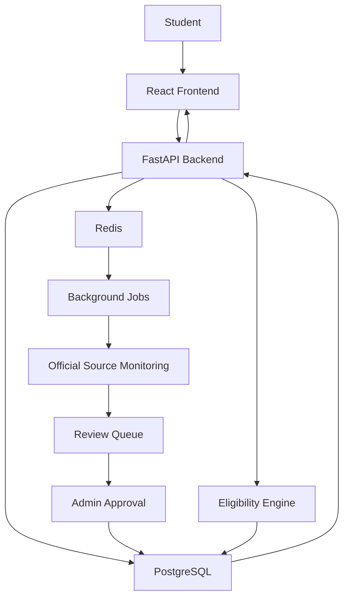

# GRANTED — FULL PRODUCT BLUEPRINT & SIX-WEEK ENGINEERING ROADMAP

**Project:** GrantEd  
**Working tagline:** More than grants. Every bit of support.  
**Product category:** Student financial support discovery and eligibility guidance platform  
**Geographic scope:** Ireland — Republic of Ireland and Northern Ireland  
**Target users:** Prospective and current higher-education students  
**Business model:** Free for students  
**Development target:** One complete, deployed MVP in 42 days  
**Engineering approach:** AI-assisted development with strong emphasis on retaining independent engineering knowledge  
**Status:** Initial product blueprint — scope and name may evolve as research progresses

---

# PART 1 — YOUR ROLE AS MY ENGINEERING PARTNER

I am building GrantEd as a serious full-stack portfolio project and potentially a real product.

Act as my:

- Senior software engineer and technical architect.
- Product manager who challenges unnecessary features.
- Data engineer and research systems designer.
- Engineering mentor who explains the reasoning behind implementation decisions.
- Code reviewer who prioritises maintainability, correctness, accessibility and security.

## How I want you to work with me

The goal is to use AI to accelerate implementation while ensuring I retain engineering knowledge.

Do not simply generate large amounts of code for me to copy and paste.

Follow this development cycle:

1. Explain the problem and the desired outcome.
2. Propose an appropriate technical design.
3. Explain the important architectural decisions and trade-offs.
4. Break the work into manageable implementation steps.
5. Help me implement the feature.
6. Explain the important sections of the code.
7. Write and run appropriate tests.
8. Review the implementation for edge cases, errors and security problems.
9. Summarise what I should understand and be able to explain in an interview.

### Engineering expectations

- Prefer simple, maintainable solutions over unnecessary complexity.
- Do not introduce microservices into this project.
- Do not add libraries or dependencies without explaining why they are needed.
- Use current, stable documentation when selecting APIs and libraries.
- Never invent API behaviour or configuration options.
- Never hardcode secrets or credentials.
- Include error handling, type hints, validation and meaningful tests.
- Follow sensible naming conventions and a consistent project structure.
- Keep business logic separate from HTTP routes and presentation components.
- Explain database relationships, asynchronous operations, authentication and deployment decisions.
- Do not replace working code unnecessarily.
- Before major changes, explain which existing files and components will be affected.
- Work in small, reviewable increments.

When I ask you to implement a feature, do not automatically produce an entire application. Implement the smallest complete vertical slice that achieves the requirement.

If something is uncertain, make a sensible assumption, document it and continue unless it would materially affect architecture or correctness.

**My learning objective:** I should be able to explain the application architecture, database design, API routes, eligibility engine, authentication, deployment and important implementation decisions independently in a software engineering interview.

---

# PART 2 — PRODUCT VISION

## 2.1 The problem

Students in Ireland have access to a wide range of financial support opportunities.

These include:

- Government grants.
- University scholarships and bursaries.
- Student hardship funds.
- Disability-related financial assistance.
- Tax reliefs and credits.
- Social welfare supports.
- Accommodation assistance.
- Transport supports.
- Charitable grants.
- Regional and private funding opportunities.

However, the information is fragmented across government departments, universities, educational institutions, charities and other organisations.

Students often do not know:

- What financial supports exist.
- Which ones they might qualify for.
- Whether they can access multiple supports simultaneously.
- Whether their parents or guardians may qualify for related reliefs.
- Which documents they need.
- When applications open and close.
- Where to apply.
- Whether an opportunity is available at their particular institution.

The problem is not necessarily a lack of funding. It is that discovering and understanding available support is difficult.

## 2.2 The solution

GrantEd is a centralised financial support discovery platform for students across the island of Ireland.

A student should be able to visit GrantEd, answer a short series of straightforward questions and receive a personalised list of financial supports that they may qualify for.

For each opportunity, GrantEd should explain:

- What the support is.
- Who provides it.
- Why the student may qualify.
- Which eligibility criteria they satisfy.
- Which criteria still need to be checked.
- How much funding or relief may be available, where an official calculation is possible.
- What documentation may be required.
- Relevant application dates and deadlines.
- How and where to apply.
- When the information was last verified.
- Which official sources support the information.

The platform should make discovering financial support considerably easier than independently searching dozens of websites.

## 2.3 Core product promise

**One assessment. A clearer picture of the financial support available to you.**

GrantEd should not just be another directory of grants.

It should become a reliable student financial support discovery and guidance system.

## 2.4 Geographic scope

The product should support both jurisdictions on the island of Ireland:

1. Republic of Ireland.
2. Northern Ireland.

This is an important architectural requirement.

Do not treat Ireland as one unified financial assistance system. Each jurisdiction can have different government departments, residency requirements, grant systems, tax rules, academic funding arrangements and legislation.

Every scheme must be associated with the jurisdiction or jurisdictions in which it applies.

Model cross-border cases explicitly. For example, a student may live in one jurisdiction and attend an institution in the other.

The data model must support this without assuming that the student's residence, nationality and study location are the same.

## 2.5 Target audience

### Prospective students

Students who have received a university offer or are considering applying to higher education.

They want to understand the financial assistance available before beginning their studies.

### Current students

Students already attending university or another eligible higher-education provider.

They may be looking for hardship assistance, scholarships, disability support, accommodation assistance or other financial relief.

### Parents and guardians

Some supports, particularly tax-related reliefs, may apply to a parent or another person who paid qualifying educational costs.

GrantEd should identify when a student may need to discuss a potential opportunity with their parent or fee payer.

Do not incorrectly present parent-related relief as money automatically payable to the student.

---

# PART 3 — THE TYPES OF SUPPORT GRANTED MUST COVER

The platform must be designed to accommodate a broad range of financial support, not just grants.

Organise opportunities into the following categories.

## 3.1 Government grants and student funding

Examples to research:

- SUSI student grants.
- Student Grant Scheme.
- Relevant maintenance and fee grants.
- 1916 Bursary Fund.
- Student Assistance Fund.
- Fund for Students with Disabilities.
- Other government-funded education assistance.

## 3.2 Institution-specific financial support

Research universities, technological universities, institutes of technology, colleges and other eligible higher-education providers.

Look for:

- Entrance scholarships.
- Academic achievement scholarships.
- Sports scholarships.
- Access scholarships.
- Socioeconomic bursaries.
- Hardship funds.
- Emergency assistance.
- Accommodation bursaries.
- Subject-specific scholarships.
- Department-specific funding.
- International student scholarships, where relevant.

Funding rules may be different at every institution.

## 3.3 Tax reliefs and credits

Research relevant student and parent-related tax relief.

Examples include:

- Third-level tuition fee tax relief.
- Rent Tax Credit.
- Other applicable education-related reliefs.
- Other relevant household or family tax credits.

Model these as a different type of financial benefit from grants.

They may depend on who paid the expense, income tax liability, the tax year and other conditions.

Do not assume the student is the person entitled to claim.

## 3.4 Social welfare and employment-related supports

Research relevant supports involving:

- Low-income households.
- Lone parents.
- Dependants.
- Carers.
- Social welfare eligibility.
- Employment status.
- Relevant education or training provisions.

Do not automatically suggest that a student is eligible for a welfare payment merely because they are enrolled in higher education.

These schemes can have complex conditions and should be treated carefully.

## 3.5 Disability and accessibility funding

Research financial assistance and services for students with disabilities, including:

- Assistive technology.
- Specialist software.
- Learning support.
- Non-medical assistance.
- Transport assistance.
- Relevant disability-related education funding.

Ask only for information needed to identify potentially relevant supports.

Do not collect diagnoses or medical documents unnecessarily.

## 3.6 Accommodation and transport assistance

Research:

- Accommodation bursaries.
- Student housing assistance.
- Regional travel support.
- Transport grants.
- Relevant public transport concessions.
- Supports for students travelling long distances.
- Other region-specific opportunities.

Distinguish financial awards from discounts or concessions.

## 3.7 Charitable and private funding

Research:

- Charitable foundations.
- Community funding.
- Private scholarships.
- Corporate education bursaries.
- Religious and community organisations, where relevant and appropriate.
- Subject-specific charitable trusts.
- Regional education funds.

Include opportunities that are not exclusively for students if a student or their parent may qualify.

---

# PART 4 — MVP SCOPE AND PRODUCT PRIORITIES

The vision is broad, but the first six weeks must remain achievable.

## 4.1 MVP must include

1. A responsive public-facing website.
2. A short, accessible student assessment questionnaire.
3. Conditional follow-up questions.
4. A structured database of verified financial support schemes.
5. A deterministic eligibility rules engine.
6. Personalised scheme recommendations.
7. Clear explanations of eligibility.
8. Official application links and supporting source links.
9. Amounts and deadlines where verified.
10. Basic search and filtering.
11. A basic scheme administration workflow.
12. Source verification and last-checked dates.
13. A deployed application.
14. Automated tests and project documentation.

## 4.2 What is not required in the initial MVP

Do not let these features delay the core application:

- AI chatbot.
- Automated submission of applications.
- Direct integration with SUSI or government accounts.
- Uploading bank statements or payslips.
- Machine learning eligibility predictions.
- Complex parent accounts.
- Full financial planning tools.
- Automated legal or tax advice.
- Complete historical funding analytics.
- Native mobile applications.
- Microservices.
- Complex recommendation algorithms.

These can be investigated later.

## 4.3 Realistic coverage expectations

The product vision is comprehensive all-island coverage.

However, it is not realistic to promise that every institution-specific bursary and every relevant social welfare provision has been fully researched, encoded and verified in six weeks.

The MVP should instead:

- Establish the national research database.
- Implement the complete data model.
- Populate a meaningful initial set of high-value opportunities.
- Include verified examples from both jurisdictions.
- Include a selection of institution-specific opportunities.
- Demonstrate the end-to-end assessment and recommendation flow.
- Clearly disclose gaps in coverage.

Never label the database comprehensive when it is not.

## 4.4 Success criteria

The MVP is successful when:

- A user can complete an assessment without assistance.
- Their answers produce relevant, explainable recommendations.
- Each published recommendation has supporting official sources.
- Eligibility is calculated by deterministic code.
- Unknown eligibility conditions are not silently treated as satisfied.
- Expired or unverified deadlines are not presented as current.
- The user can follow an official application link.
- Administrators can review and approve scheme information.
- Automated tests cover the core eligibility rules.
- The application is deployed and usable.
- The source code and architecture can be confidently explained by me.

---

# PART 5 — USER EXPERIENCE AND QUESTIONNAIRE

The assessment is one of the most important features.

It must be straightforward enough that a student can complete it quickly without understanding grant terminology.

Use a two-stage questionnaire.

**Stage 1:** Short initial assessment.

**Stage 2:** Conditional questions based on the answers and potentially relevant schemes.

Ask only for information that can change the recommendations.

## 5.1 Initial questionnaire

Suggested first-stage questions:

1. Are you planning to start higher education, or are you already studying?
2. Where do you currently live?
3. Where do you plan to study or currently study?
4. Which college or university do you attend or intend to attend?
5. What type of course are you studying or applying for?
6. Are you studying full-time or part-time?
7. What year of study are you entering or currently in?
8. What is your approximate household income band?

The precise wording and available options should be refined after researching actual eligibility requirements.

## 5.2 Conditional questions

Only ask additional questions when relevant.

Potential follow-ups:

- Do you live with your parents or independently?
- Are you financially dependent on your parents or guardians?
- Have you lived in Ireland, Northern Ireland, the UK, EU or elsewhere during the relevant period?
- What is your nationality or relevant residency category?
- Have you previously completed a higher-education qualification?
- Are you repeating a year or changing courses?
- Do you have children or other financial dependants?
- Are you a lone parent?
- Are you currently employed?
- Do you receive relevant social welfare payments?
- Would you like to explore disability-related student support?
- Do you rent accommodation?
- Do you travel to college from outside the local area?
- Is a parent or guardian paying your qualifying third-level fees?

Not all questions should be asked for every student.

For example, a disability-related question should only appear when relevant and should allow the student to decline to answer.

## 5.3 Question design principles

- Use simple, everyday language.
- Avoid long legal explanations.
- Explain why sensitive questions are being asked.
- Use income ranges where possible rather than exact income.
- Provide a "Not sure" option.
- Provide "Prefer not to say" for sensitive questions.
- Do not force the user to complete irrelevant questions.
- Never request PPS numbers, bank details or document uploads.
- Distinguish between the student, their household and the person who may claim a tax credit.
- Allow users to revise their answers.
- Use a progress indicator.
- Make the interface accessible by keyboard and screen reader.

## 5.4 Questionnaire output

The assessment should produce a structured profile.

Example:

```json
{
  "study_status": "prospective",
  "jurisdiction_of_residence": "republic_of_ireland",
  "study_jurisdiction": "republic_of_ireland",
  "institution_id": "example_institution",
  "course_type": "undergraduate",
  "study_mode": "full_time",
  "year_of_study": 1,
  "household_income_band": "30000_40000",
  "accommodation_status": "living_with_parents",
  "employment_status": "part_time",
  "dependants": false
}
```

This is an illustrative structure only. Final fields must be based on researched eligibility requirements.

## 5.5 Results page

Group recommendations into three categories.

### Likely eligible

The known information satisfies the documented eligibility conditions.

This is not an official eligibility decision.

### Potentially eligible — check further

The student satisfies some conditions, but further information, documentation or an institutional decision is required.

### More information needed

One or more important conditions are unknown.

Explain what information would be required to assess the opportunity further.

Avoid an "ineligible" result unless there is a clear, verified exclusion condition.

## 5.6 Individual scheme card

Every recommendation should display:

- Scheme name.
- Provider.
- Support category.
- Jurisdiction.
- Short description.
- Potential funding amount or benefit.
- Eligibility result.
- Why the scheme was recommended.
- Conditions to verify.
- Application deadline or status.
- Documentation guidance.
- Official application link.
- Official source links.
- Last verified date.
- Relevant academic year or tax year.

Do not estimate funding amounts when the official rules do not support a reliable calculation.

---

# PART 6 — NATIONAL RESEARCH DATABASE

**Research first, build second.**

The research database is the foundation of the product.

A beautiful website with inaccurate funding information is worse than a smaller platform with carefully verified information.

The research process must therefore be treated as a core product system.

## 6.1 Official source hierarchy

Prioritise sources in this order:

**Tier 1 — Official primary sources**

- Government departments.
- SUSI.
- Higher Education Authority.
- Revenue Commissioners.
- Student Finance Northern Ireland.
- Northern Ireland government departments.
- Official university and college websites.
- Official charitable foundation websites.
- Official scheme application portals.

**Tier 2 — Established public information sources**

- Citizens Information.
- Relevant education bodies.
- Student representative organisations.
- Specialist disability and accessibility organisations.
- Other recognised public-interest organisations.

Tier 2 sources can help discover schemes and explain them, but primary official sources should verify current eligibility and amounts wherever possible.

**Tier 3 — Discovery sources**

- News articles.
- Blogs.
- Search results.
- Social media.
- Forums.
- Student discussions.

Use these to discover possible opportunities, not as the sole basis for publishing eligibility rules.

## 6.2 Initial research sources

Begin with these official sources.

### Republic of Ireland

**SUSI**

https://www.susi.ie/

Research nationality, residency, household income, progression, approved courses, institutions, grant rates and academic-year changes.

**Department of Further and Higher Education**

https://www.gov.ie/en/department-of-further-and-higher-education-research-innovation-and-science/

Research student grant schemes, legislation, policy documents and updates.

**Higher Education Authority**

https://hea.ie/

Research:

- Student Assistance Fund.
- 1916 Bursary.
- Fund for Students with Disabilities.
- Institution participation.
- Student finance guidelines.

Relevant pages:

https://hea.ie/funding-governance-performance/funding/student-finance/

https://hea.ie/funding-governance-performance/funding/student-finance/1916-bursary/

https://hea.ie/funding-governance-performance/funding/student-finance/student-assistance-fund/

https://hea.ie/funding-governance-performance/funding/student-finance/fund-for-students-with-disabilities/

**Revenue Commissioners**

https://www.revenue.ie/

Research:

- Third-level tuition fee tax relief.
- Rent Tax Credit.
- Relevant parent or fee-payer entitlements.
- Annual tax changes and eligibility.

Relevant pages:

https://www.revenue.ie/en/personal-tax-credits-reliefs-and-exemptions/education/tuition-fees-paid-for-third-level-education/index.aspx

https://www.revenue.ie/en/personal-tax-credits-reliefs-and-exemptions/land-and-property/rent-credit/index.aspx

**Quality and Qualifications Ireland**

https://www.qqi.ie/

Use this and other official education-sector sources to help establish the provider inventory.

Do not assume that one list of institutions represents every eligible higher-education provider. Verify the population and eligibility of providers against the relevant official registers and scheme rules.

### Northern Ireland

**Student Finance Northern Ireland**

https://www.studentfinanceni.co.uk/

Research tuition fee loans, maintenance support, eligibility, residency rules, dependants and study-location differences.

**Department for the Economy**

https://www.economy-ni.gov.uk/

Research higher education funding policy and relevant student-support arrangements.

**GOV.UK**

https://www.gov.uk/student-finance

Use as an additional source for relevant UK student finance rules.

### Privacy and data protection

**Data Protection Commission**

https://www.dataprotection.ie/

Research GDPR, special category data, data minimisation and Data Protection Impact Assessments.

**Information Commissioner's Office**

https://ico.org.uk/

Research relevant UK data protection guidance for Northern Ireland users.

## 6.3 Institution research

Build a structured inventory of institutions and providers.

The inventory should include:

- Universities.
- Technological universities.
- Institutes of technology.
- Other eligible publicly funded colleges.
- Relevant private and independent higher-education providers.
- Other approved providers where a specific support scheme applies.

For every institution, identify:

1. Official website.
2. Student finance or funding page.
3. Access office.
4. Scholarships and bursaries page.
5. Student assistance or hardship support.
6. Disability support.
7. Accommodation support.
8. International student funding, where relevant.
9. Department-specific scholarships.
10. Relevant deadlines and application links.

Create a reusable research checklist for each provider.

Do not assume that an institution participates in a national scheme simply because it is a higher-education provider. Verify participation scheme by scheme.

## 6.4 Research categories

Create a database inventory using the following categories:

| Category | Main research target |
|---|---|
| Government grants | SUSI, student grant schemes |
| Bursaries | 1916 Bursary, access funding |
| Hardship | Student Assistance Fund, institutional funds |
| Disability | Fund for Students with Disabilities, institutional support |
| Scholarships | University and college awards |
| Tax relief | Tuition fees, rent and relevant credits |
| Social welfare | Relevant student and household supports |
| Accommodation | Housing bursaries and assistance |
| Transport | Travel and regional assistance |
| Charitable | Foundations, trusts and organisations |
| Private | Corporate and independently funded scholarships |

## 6.5 Standard research record

Every scheme must have a structured research record.

Required fields:

- Scheme name.
- Scheme identifier.
- Provider organisation.
- Category.
- Subcategory.
- Jurisdiction.
- Geographic restrictions.
- Description.
- Target applicants.
- Prospective student applicability.
- Current student applicability.
- Eligible institutions.
- Eligible courses.
- Course level.
- Full-time/part-time restrictions.
- Nationality conditions.
- Residency conditions.
- Income conditions.
- Household assessment rules.
- Progression and previous study rules.
- Other eligibility conditions.
- Exclusions.
- Funding amount or calculation method.
- Funding currency.
- Frequency of award.
- Application opening date.
- Application closing date.
- Current application status.
- Required documentation.
- Application method.
- Official application URL.
- Official source URLs.
- Source publication date.
- Academic year or tax year.
- Date last checked.
- Next review date.
- Confidence or verification status.
- Notes and unresolved questions.

Do not leave important unknowns empty without explanation. Represent unknown information explicitly.

## 6.6 Academic-year and tax-year versioning

Do not overwrite old funding rules when new rules are published.

A scheme might exist across multiple years with different thresholds, amounts or eligibility requirements.

Each scheme version should have:

- Valid academic year or tax year.
- Effective start date.
- Effective end date where applicable.
- Rule version.
- Amount version.
- Application deadline version.
- Source references.
- Change summary.
- Verification date.

Preserve previous versions for historical analysis.

This is particularly important when research begins during one academic year and continues into the next.

## 6.7 Research database workflow

Use the following process:

1. Discover an opportunity.
2. Record its official provider and primary source.
3. Read the source and extract its conditions.
4. Identify applicable jurisdiction and academic year.
5. Convert the information into the structured research record.
6. Identify all unknowns and ambiguities.
7. Verify key conditions against the official guidelines or application documentation.
8. Review the record manually.
9. Approve it for publication.
10. Add it to the eligibility engine if the rules are sufficiently understood.
11. Schedule a future verification date.

An AI model may help summarise official documents and draft structured records.

It must not publish extracted eligibility rules without human review.

## 6.8 Data verification status

Every record must have one of these statuses:

- Discovered.
- Researching.
- Awaiting verification.
- Verified.
- Published.
- Review required.
- Expired.
- Archived.

Only verified records can be published.

If an important deadline or eligibility requirement cannot be verified, the platform must communicate that uncertainty.

## 6.9 Automated monitoring

Develop an automated monitoring process to identify possible changes to official scheme information.

Possible techniques:

- HTTP last-modified checks where available.
- ETag comparison.
- Page content hashes.
- Scheduled retrieval.
- Sitemap monitoring.
- RSS feeds.
- Official announcement monitoring.
- Document version comparison.
- Manual review reminders.

For websites and documents, obey terms of use, access controls and robots restrictions. Do not bypass restrictions or overload websites.

When a difference is detected:

1. Record the source.
2. Store the detection date.
3. Generate a change notification.
4. Compare the newly retrieved information with the previous version.
5. Place the affected scheme into a review queue.
6. Have a human verify the change.
7. Publish an approved updated version.
8. Preserve the old version and change history.

**Never automatically publish a change to eligibility requirements, funding amounts or deadlines based solely on a scraper or AI extraction.**

## 6.10 Research freshness targets

Proposed internal targets:

- National schemes: review at least once per academic-year cycle and whenever official changes are detected.
- Tax credits: review on each relevant tax-year change and after relevant budget or legislation announcements.
- Institution-specific schemes: review before their expected application period and at least once per academic year.
- Time-sensitive deadlines: recheck more frequently as the deadline approaches.
- Expired opportunities: retain historically but clearly remove them from current recommendations.

These are operational targets, not claims about how often official sources update.

---

# PART 7 — ELIGIBILITY ENGINE

This is the most important technical component of GrantEd.

The engine must be deterministic, explainable and versioned.

**An LLM must never make the final eligibility decision.**

AI can assist with source discovery, extraction and explanations, but the application must use normal software logic to evaluate eligibility.

## 7.1 Why a deterministic engine?

Eligibility rules frequently contain:

- Income thresholds.
- Residency periods.
- Nationality conditions.
- Age restrictions.
- Study-level conditions.
- Approved institution lists.
- Progression requirements.
- Previous education restrictions.
- Household circumstances.
- Course duration rules.
- Academic-year-specific amounts.

These conditions need consistent and repeatable evaluation.

The same answers, against the same scheme version, must produce the same outcome.

## 7.2 Three-valued eligibility logic

Do not use a simplistic yes/no system.

Every condition should be evaluated as:

- TRUE — condition satisfied.
- FALSE — condition not satisfied.
- UNKNOWN — insufficient information or unresolved ambiguity.

The overall result should consider every relevant condition.

Example:

A student satisfies nationality and institution conditions but has not provided enough information about household income.

The outcome should be:

**Potentially eligible — more information required.**

It must not be classified as fully eligible.

## 7.3 Rule engine structure

Represent each rule using a validated, structured format.

Example:

```json
{
  "scheme_id": "example_scheme",
  "academic_year": "2026/2027",
  "rules": {
    "operator": "AND",
    "conditions": [
      {
        "field": "study_mode",
        "operator": "equals",
        "value": "full_time"
      },
      {
        "field": "course_level",
        "operator": "in",
        "value": ["undergraduate", "postgraduate"]
      },
      {
        "field": "household_income",
        "operator": "less_than_or_equal",
        "value": 40000
      }
    ]
  }
}
```

This is an illustrative example only. It must not be interpreted as an actual scheme's eligibility criteria.

Use a restricted and validated rule language.

Supported operators might include:

- equals.
- not equals.
- greater than.
- greater than or equal.
- less than.
- less than or equal.
- in.
- not in.
- contains.
- before.
- after.
- exists.
- missing.

Support AND, OR and NOT groupings with clear rules about missing values.

Do not use unrestricted Python `eval`, dynamically execute expressions from database records or allow arbitrary code to be stored as a scheme rule.

## 7.4 Eligibility explanation

The engine should return an explanation alongside every result.

For example:

```json
{
  "scheme_id": "example_scheme",
  "result": "potentially_eligible",
  "conditions": [
    {
      "condition": "study_mode",
      "result": "pass",
      "explanation": "You are studying full-time."
    },
    {
      "condition": "institution",
      "result": "pass",
      "explanation": "Your institution is listed as eligible."
    },
    {
      "condition": "household_income",
      "result": "unknown",
      "explanation": "More information is needed to assess the income requirement."
    }
  ],
  "next_steps": [
    "Check the scheme's current income criteria.",
    "Contact the institution's student support office."
  ]
}
```

Each explanation should be traceable to the specific scheme rule and its source.

## 7.5 Complex and discretionary schemes

Some schemes involve an individual assessment by a university, access office, welfare officer or committee.

The engine cannot replicate a human decision that depends on individual circumstances or discretion.

For these schemes:

- Evaluate only objective conditions that are officially documented.
- Return "Potentially eligible" where appropriate.
- Explain that the provider makes the final decision.
- Show the correct contact details and application route.

Do not create artificial certainty.

## 7.6 Funding estimates

The system may calculate estimated funding where an official formula exists.

For every calculation, store:

- Input variables.
- Applicable rule version.
- Calculation method.
- Funding year.
- Result.
- Limitations.
- Official source.

Never show an estimated amount as guaranteed funding.

Where a reliable calculation is impossible, display the official published amount or explain that the provider determines the award.

## 7.7 Tax reliefs

Tax relief must be treated separately from grants.

The system needs to identify:

- Who incurred the qualifying expense.
- Who paid it.
- Which tax year is relevant.
- Whether the relief requires an income tax liability.
- Whether the student or another person may claim.
- Relevant limits and exclusions.

Where appropriate, present a separate parent/fee-payer action.

Do not combine a student's grant estimates and a parent's potential tax relief into a single total without explaining who may receive each benefit.

---

# PART 8 — TECHNICAL ARCHITECTURE

## 8.1 Core architecture decision

Use a **modular monolith**.

The project does not need microservices.

A modular monolith keeps development and deployment manageable while retaining clear separation of responsibilities.

Build a well-structured application that can grow without unnecessary infrastructure.

## 8.2 Technology stack

### Backend

- Python.
- FastAPI.
- Pydantic.
- SQLAlchemy.
- Alembic.
- Pytest.

### Database

- PostgreSQL.
- JSONB for validated flexible rule structures where appropriate.
- Proper foreign keys, constraints and indexes.
- Database migrations using Alembic.

### Frontend

- React.
- TypeScript.
- Vite.
- React Router.
- TanStack Query where beneficial.
- Accessible form components.
- Tailwind CSS or a small, consistent styling system.

### Background processing

- Redis.
- RQ or another lightweight Redis-backed job system.

Use background jobs for source monitoring, data checks and other operations that do not need to block a normal user request.

Do not introduce background-processing complexity before the main application works.

### Development and deployment

- Git and GitHub.
- Docker and Docker Compose.
- AWS.
- Terraform.
- GitHub Actions.
- AWS S3.
- AWS EC2 for the initial cost-conscious deployment.
- AWS CloudWatch or equivalent basic monitoring.

## 8.3 High-level architecture



## 8.4 Backend modules

Organise backend responsibilities into separate modules:

- `auth`
- `users`
- `institutions`
- `schemes`
- `eligibility`
- `assessments`
- `recommendations`
- `sources`
- `research`
- `admin`
- `notifications`
- `analytics`

Do not create a separate service or deployment for each module.

## 8.5 Suggested project structure

```text
granted/
│
├── backend/
│   ├── app/
│   │   ├── api/
│   │   │   └── v1/
│   │   ├── core/
│   │   ├── models/
│   │   ├── schemas/
│   │   ├── services/
│   │   │   ├── eligibility/
│   │   │   ├── recommendations/
│   │   │   └── research/
│   │   ├── repositories/
│   │   ├── workers/
│   │   └── main.py
│   ├── tests/
│   ├── alembic/
│   ├── requirements.txt
│   └── Dockerfile
│
├── frontend/
│   ├── src/
│   │   ├── components/
│   │   ├── pages/
│   │   ├── features/
│   │   ├── hooks/
│   │   ├── services/
│   │   ├── types/
│   │   └── App.tsx
│   ├── package.json
│   └── Dockerfile
│
├── research/
│   ├── sources/
│   ├── scheme_inventory/
│   ├── institution_inventory/
│   └── research_notes/
│
├── infrastructure/
│   └── terraform/
│
├── docs/
│   ├── architecture.md
│   ├── database.md
│   ├── eligibility-engine.md
│   ├── privacy.md
│   └── research-methodology.md
│
├── docker-compose.yml
├── README.md
└── .gitignore
```

The exact structure may evolve as implementation progresses.

## 8.6 Database design

Design the database before implementing the main features.

Suggested entities:

### `users`

Stores minimal account information.

Fields may include:

- id.
- email.
- password hash or external authentication identifier.
- created_at.
- updated_at.

### `institutions`

Stores educational providers.

Fields:

- id.
- name.
- jurisdiction.
- provider_type.
- official_website.
- status.
- created_at.
- updated_at.

### `courses`

Stores relevant course information where required.

Fields:

- id.
- institution_id.
- name.
- qualification_level.
- study_mode.
- duration.
- approval_status.
- source_id.

Do not attempt to build a complete course catalogue unless necessary for researched rules.

### `organisations`

Stores government departments, universities, charitable foundations and other providers.

### `schemes`

Stores the identity and permanent details of a financial support opportunity.

Fields:

- id.
- slug.
- name.
- organisation_id.
- category_id.
- description.
- jurisdiction.
- official_url.
- publication_status.

### `scheme_versions`

Stores year-specific scheme information.

Fields:

- id.
- scheme_id.
- academic_year.
- tax_year.
- valid_from.
- valid_to.
- application_open_date.
- application_close_date.
- amount_details.
- eligibility_summary.
- rule_version.
- verification_status.
- last_verified_at.
- next_review_at.
- change_summary.

A scheme version should be retained rather than overwritten.

### `eligibility_rules`

Stores the validated machine-readable eligibility requirements.

Fields:

- id.
- scheme_version_id.
- rule_definition.
- rule_schema_version.
- created_at.
- approved_at.

### `sources`

Stores primary and secondary evidence.

Fields:

- id.
- organisation.
- title.
- URL.
- source_type.
- publication_date.
- last_checked_at.
- content_hash.
- reliability_status.

### `scheme_sources`

Links schemes and versions to supporting sources.

Fields:

- scheme_version_id.
- source_id.
- evidence_description.
- relevant_section.
- verified_by.
- verified_at.

### `assessments`

Stores assessment sessions.

Fields:

- id.
- user_id, nullable for guest assessments.
- jurisdiction.
- study_status.
- started_at.
- completed_at.

### `assessment_answers`

Stores answers to the questionnaire.

Fields:

- id.
- assessment_id.
- field_name.
- answer_value.
- created_at.

Avoid retaining sensitive answers unnecessarily.

### `recommendations`

Stores calculated results.

Fields:

- id.
- assessment_id.
- scheme_version_id.
- eligibility_status.
- explanation.
- calculated_at.
- rule_version_used.

### `saved_schemes`

Links users to saved opportunities.

### `application_tracking`

Allows users to record that they intend to apply, have started an application or have submitted it.

This should be a reminder and tracking feature, not an official application integration.

### `change_events`

Stores detected changes to official source information.

### `review_tasks`

Stores manual verification and publication tasks.

### `audit_logs`

Stores important administrative changes and approval actions.

## 8.7 Data integrity

Use:

- Foreign key constraints.
- Unique constraints.
- Database migrations.
- Validation at API boundaries.
- Transaction management.
- Immutable published versions where practical.
- Audit history for important administrative changes.

Do not allow a published scheme version to have missing essential source information.

## 8.8 API design

Use a versioned API.

Suggested routes:

```text
/api/v1/auth/register
/api/v1/auth/login
/api/v1/auth/logout

/api/v1/institutions
/api/v1/institutions/{institution_id}

/api/v1/schemes
/api/v1/schemes/{scheme_id}

/api/v1/assessments
/api/v1/assessments/{assessment_id}/answers
/api/v1/assessments/{assessment_id}/results

/api/v1/recommendations

/api/v1/saved-schemes
/api/v1/application-tracking

/api/v1/admin/schemes
/api/v1/admin/sources
/api/v1/admin/review-queue
/api/v1/admin/change-events
```

These are proposed routes, not a requirement to implement every endpoint in the MVP.

Use Pydantic request and response schemas.

Validate inputs server-side.

Do not expose unpublished schemes or internal source review information through public endpoints.

## 8.9 Authentication

Implement authentication only to the extent required for the MVP.

Support a guest assessment where practical.

Allow registered students to save results and opportunities.

Use secure password hashing if managing passwords directly.

Protect account-related routes, use secure session handling and avoid putting long-lived authentication tokens in browser local storage.

Use role-based permissions for administrative functionality.

Never allow a normal student account to approve or publish scheme updates.

---

# PART 9 — PRIVACY, SECURITY AND TRUST

This platform may deal with information about household finances, residency, disability and other personal circumstances.

Privacy cannot be an afterthought.

## 9.1 Data minimisation

Do not collect:

- PPS numbers.
- Bank account details.
- Bank statements.
- Payslips.
- Tax returns.
- Passwords for government accounts.
- Full medical histories.
- Disability diagnoses unless strictly necessary and appropriately justified.
- Copies of identity documents.

Use approximate income bands where that is sufficient.

Ask only the questions required to provide useful recommendations.

## 9.2 Sensitive information

Information about health and disability can constitute special category personal data under GDPR.

Before collecting such information, assess the legal basis and applicable Article 9 condition, purpose, retention and safeguards.

Do not assume that asking for consent automatically resolves every data protection requirement.

Where possible, provide an option that identifies disability-related assistance without collecting a diagnosis.

Allow the student to skip the question and explain that some opportunities may not be identified as a result.

## 9.3 User control

Users should be able to:

- Review their assessment answers.
- Change their answers.
- Delete an assessment.
- Delete their account.
- Understand what data is stored.
- Understand why each question is asked.

Set reasonable retention limits.

Do not retain assessment data indefinitely.

## 9.4 Security

Implement:

- HTTPS.
- Secure password hashing.
- Authentication and authorisation.
- Input validation.
- Rate limiting.
- Secure secret management.
- Least-privilege database access.
- Protection against SQL injection and cross-site scripting.
- Secure HTTP headers.
- Dependency vulnerability checks.
- Database backups.
- Logging that does not expose sensitive answers.
- Access controls for administration.

Do not send real student financial or disability data to external AI services during development or production unless a properly assessed and approved data-processing arrangement exists.

## 9.5 Legal and compliance review

Before public launch:

- Review the applicable GDPR and UK GDPR requirements.
- Determine the controller and processor roles.
- Prepare a clear privacy notice.
- Define a lawful basis for each purpose.
- Review whether a Data Protection Impact Assessment is required.
- Consider the additional safeguards needed for special category data.
- Review data retention and deletion procedures.
- Review the accuracy of the platform's disclaimers.

Obtain qualified legal or data protection advice where necessary.

## 9.6 Clear user-facing disclaimer

GrantEd provides general information and eligibility guidance.

It does not:

- Make official funding decisions.
- Guarantee that a student qualifies.
- Replace the official scheme application process.
- Replace professional tax or legal advice.
- Guarantee that published awards will remain available.

Final eligibility and award decisions remain with the relevant official provider.

---

# PART 10 — DATA FRESHNESS AND ADMINISTRATION

The research system needs a basic administrative workflow.

An administrator should be able to:

1. Add a scheme.
2. Add official sources.
3. Create a year-specific scheme version.
4. Enter eligibility conditions.
5. Enter amounts and deadlines.
6. Mark unknown conditions.
7. Submit the record for verification.
8. Approve or reject the record.
9. Publish the approved version.
10. Record a change to a published scheme.
11. Archive an old version.

## 10.1 Verification workflow

Use the following sequence:

```text
DISCOVERED
    |
    v
RESEARCHING
    |
    v
AWAITING VERIFICATION
    |
    v
VERIFIED
    |
    v
PUBLISHED
    |
    v
CHANGE DETECTED
    |
    v
REVIEW REQUIRED
    |
    v
APPROVED UPDATED VERSION
```

A detected change must not automatically replace a published record.

## 10.2 Minimum administrative interface

For the first release, the admin functionality can be relatively simple.

It should provide:

- Scheme list.
- Scheme detail.
- Add/edit scheme form.
- Sources section.
- Verification status.
- Review queue.
- Change history.
- Publish/archive action.

The initial interface does not need sophisticated workflow automation.

Correct data and a reliable review process are more important than a complex admin dashboard.

---

# PART 11 — FRONTEND DESIGN AND ACCESSIBILITY

The product should feel friendly, trustworthy and accessible.

GrantEd should not look like a government portal or a spreadsheet database.

## 11.1 Branding

Working name: **GrantEd**

Brand idea: Granted + educated.

Positioning: More than grants. Every bit of support.

Personality:

- Friendly.
- Helpful.
- Clear.
- Trustworthy.
- Student-focused.
- Modern without looking overly corporate.

Keep the working name flexible. Reconsider it if research discovers a major naming conflict or a stronger direction.

## 11.2 Core pages

### Landing page

Explain:

- What GrantEd does.
- Who it is for.
- Which types of support it covers.
- How the assessment works.
- Why students should trust its sources.

Primary action: Start your assessment.

### Assessment

Use a step-by-step questionnaire.

Avoid overwhelming the student with too many questions at once.

### Results

Show relevant opportunities, eligibility explanations, missing information and next steps.

### Scheme details

Show the complete description, conditions, funding details, official sources, deadline and application instructions.

### Browse schemes

Allow browsing and filtering by:

- Jurisdiction.
- Institution.
- Category.
- Study level.
- Prospective/current student.
- Application status.

### Saved opportunities

Allow registered students to save schemes.

### Application tracking

Allow students to record application progress and relevant deadlines.

### About and methodology

Explain where information comes from, how schemes are verified and what GrantEd can and cannot determine.

### Admin

Provide the basic research and approval workflow.

## 11.3 Accessibility requirements

Target WCAG 2.2 AA.

Focus on:

- Semantic HTML.
- Keyboard accessibility.
- Clear focus states.
- Form labels.
- Helpful error messages.
- Colour contrast.
- Screen-reader support.
- Responsive layouts.
- Accessible progress indicators.
- Avoiding colour as the only indication of status.
- Plain English.

Test the assessment with keyboard navigation and accessibility tools.

---

# PART 12 — SIX-WEEK ENGINEERING ROADMAP

## Overall schedule

Duration: 42 days.

Expected development time: 12–15 hours per week, with up to 18 hours when other commitments are lighter.

Target: One complete, deployed MVP with a credible engineering foundation.

The main development work should take priority over secondary features.

The roadmap is deliberately incremental. Each week must produce a usable deliverable.

## WEEK 1 — RESEARCH, REQUIREMENTS, PYTHON, GIT, SQL AND TESTING

**Goal:** Understand the problem, create the national research foundation and prepare the technical environment.

### Day 1 — Project setup and requirements

- Create a GitHub repository.
- Configure the local development environment.
- Create a README.
- Write the product requirements.
- Define the MVP boundaries.
- Record core assumptions.
- Create an initial architecture diagram.
- Create a development task board.

Learn or revise:

- Git basics.
- Branches.
- Commits.
- Pull requests.
- Python project organisation.

**Deliverable:** Repository, README and agreed MVP specification.

### Day 2 — National scheme research

- Set up the scheme inventory.
- Create a source register.
- Identify the major government support categories.
- Start with SUSI, HEA and Revenue sources.
- Identify relevant Northern Ireland student finance sources.
- Record the applicable jurisdiction for each opportunity.

**Deliverable:** Initial official source database and research spreadsheet/CSV.

### Day 3 — Institution research

- Build an initial provider inventory.
- Research official student finance pages.
- Identify scholarships, bursaries and hardship assistance.
- Document how institution-specific opportunities differ.
- Record missing or unresolved information.

**Deliverable:** Initial institution inventory and scheme discovery list.

### Day 4 — Database design

- Define the core entities.
- Create an ER diagram.
- Identify relationships.
- Define scheme versioning.
- Design sources and evidence relationships.
- Design assessment and recommendation records.

Learn or revise:

- SQL.
- Relational database design.
- Normalisation.
- Foreign keys.
- Indexes.
- Constraints.
- JSONB.

**Deliverable:** Documented database design.

### Day 5 — Python and automated testing

- Refresh Python fundamentals.
- Review functions, classes and modules.
- Review exceptions and type hints.
- Write small validation functions.
- Set up Pytest.
- Create initial unit tests.
- Create database connection configuration.

**Deliverable:** Working Python environment and test setup.

### Day 6 — Rule engine specification

- Define the eligibility data structure.
- Define TRUE, FALSE and UNKNOWN.
- Define supported logical operators.
- Define how unknown information is handled.
- Write sample eligibility rules.
- Document expected explanations.

**Deliverable:** Eligibility engine design document.

### Day 7 — Review and consolidation

- Review the repository.
- Check database design.
- Review the research records.
- Fix inconsistencies.
- Update documentation.
- Create the Week 2 task list.

**Week 1 acceptance criteria:**

- Repository is organised.
- Requirements are documented.
- Research database is established.
- Initial scheme and provider inventory exists.
- Database design is approved.
- Eligibility engine has a documented specification.
- Tests run successfully.

---

## WEEK 2 — FASTAPI, POSTGRESQL, AUTHENTICATION AND ELIGIBILITY LOGIC

**Goal:** Build the backend and implement the core data and eligibility functionality.

### Day 8 — Backend foundation

- Create FastAPI application.
- Configure environment variables.
- Set up application settings.
- Create API versioning structure.
- Add health-check route.
- Configure database connection.

Learn or revise:

- REST APIs.
- HTTP methods.
- Status codes.
- Dependency injection.
- Pydantic.

**Deliverable:** Running FastAPI backend.

### Day 9 — PostgreSQL and SQLAlchemy

- Connect PostgreSQL.
- Create SQLAlchemy models.
- Implement initial migrations.
- Build institution and organisation models.
- Build scheme and scheme-version models.
- Add source relationships.

Learn or revise:

- ORM concepts.
- Transactions.
- Migrations.
- Database relationships.

**Deliverable:** Working database with initial schema.

### Day 10 — Scheme CRUD

- Implement scheme creation.
- Implement scheme listing.
- Implement scheme detail.
- Implement scheme editing.
- Add filtering by jurisdiction and category.
- Add validation and error handling.

**Deliverable:** Functional scheme API.

### Day 11 — Eligibility engine

- Implement the rule evaluator.
- Add AND, OR and NOT logic.
- Implement supported comparison operators.
- Implement UNKNOWN handling.
- Add explanation generation.
- Prevent arbitrary execution of stored expressions.

**Deliverable:** First deterministic eligibility evaluator.

### Day 12 — Eligibility integration

- Connect scheme rules to scheme versions.
- Build sample assessment input.
- Evaluate multiple schemes against the input.
- Return results grouped by outcome.
- Include source and rule-version metadata.

**Deliverable:** Working eligibility API.

### Day 13 — Authentication and permissions

- Implement basic registration and login if required.
- Secure password handling.
- Protect user-specific routes.
- Add administrator role checks.
- Add validation and error responses.

**Deliverable:** Basic secure authentication and permissions.

### Day 14 — Backend integration and testing

- Test all major endpoints.
- Write integration tests.
- Test missing and invalid fields.
- Test rule boundaries.
- Test database constraints.
- Fix errors.

**Week 2 acceptance criteria:**

- FastAPI backend works.
- PostgreSQL schema exists.
- Scheme CRUD is functional.
- Eligibility rules are evaluated deterministically.
- Unknown conditions are handled correctly.
- Explanations are returned.
- Authentication is implemented to the MVP requirement.
- Automated backend tests pass.

---

## WEEK 3 — REACT, QUESTIONNAIRE, RESULTS AND REDIS

**Goal:** Build the actual student experience.

### Day 15 — React foundation

- Create React application.
- Configure TypeScript.
- Set up routing.
- Create shared layout.
- Create design tokens.
- Connect frontend to backend.
- Implement loading and error handling.

**Deliverable:** Working frontend connected to the API.

### Day 16 — Initial questionnaire

- Implement first-stage questions.
- Add controlled form state.
- Add conditional follow-up questions.
- Validate responses.
- Add progress indicator.
- Add "Not sure" and "Prefer not to say" options.

**Deliverable:** Complete initial assessment flow.

### Day 17 — Assessment API integration

- Submit questionnaire answers.
- Save assessment where appropriate.
- Retrieve assessment results.
- Handle failed submissions.
- Handle incomplete information.
- Confirm data is handled securely.

**Deliverable:** End-to-end assessment functionality.

### Day 18 — Results interface

- Create recommendation cards.
- Show eligibility status.
- Explain matched conditions.
- Explain missing information.
- Show next steps.
- Display source links.
- Display verification dates.

**Deliverable:** Personalised results page.

### Day 19 — Search and scheme discovery

- Create scheme browsing page.
- Add category filtering.
- Add jurisdiction filtering.
- Add institution filtering.
- Implement basic search.
- Add scheme detail pages.

**Deliverable:** Browseable scheme catalogue.

### Day 20 — Saved schemes and accessibility

- Implement saved opportunities if account functionality is ready.
- Build a basic application-tracking feature if time allows.
- Review mobile layout.
- Test keyboard navigation.
- Fix semantic and accessibility issues.
- Improve form error messages.

**Deliverable:** More complete user experience.

### Day 21 — Redis and background processing

- Add Redis.
- Choose a lightweight background job framework.
- Implement a basic background job.
- Test asynchronous processing.
- Keep source-monitoring work separate from user request handling.

**Deliverable:** Working background job infrastructure.

**Week 3 acceptance criteria:**

- Student can complete an assessment.
- Assessment data reaches the backend.
- Results appear correctly.
- Scheme detail pages work.
- Search and filters work.
- Missing information is explained.
- Layout is responsive.
- Basic background processing works.

---

## WEEK 4 — DOCKER, AWS AND DEPLOYMENT

**Goal:** Make GrantEd available online.

### Day 22 — Docker

- Create backend Dockerfile.
- Create frontend Dockerfile.
- Create Docker Compose configuration.
- Containerise PostgreSQL.
- Containerise Redis.
- Configure development environment variables.
- Test clean startup.

**Deliverable:** Reproducible local development environment.

### Day 23 — AWS preparation

- Review AWS architecture.
- Create deployment plan.
- Configure least-privilege IAM.
- Configure security groups.
- Set up required infrastructure.
- Create budget alerts.

**Deliverable:** Prepared AWS environment.

### Day 24 — Backend deployment

- Deploy FastAPI application.
- Configure runtime variables.
- Connect database.
- Configure health checks.
- Confirm API routes work online.
- Check server logs.

**Deliverable:** Deployed backend.

### Day 25 — Frontend deployment

- Build production React application.
- Deploy static frontend to S3.
- Configure CloudFront if appropriate.
- Configure API connection.
- Test frontend and backend together.

**Deliverable:** Publicly accessible GrantEd website.

### Day 26 — Persistence and backups

- Configure persistent database storage.
- Implement database backup process.
- Test backup restoration.
- Store relevant source metadata and approved files where appropriate.
- Review storage permissions.

**Deliverable:** Reliable initial persistence and backup process.

### Day 27 — Configuration and monitoring

- Configure secure environment variables.
- Review logging.
- Configure basic monitoring.
- Check error reporting.
- Verify HTTPS.
- Review costs.

**Deliverable:** Production configuration and monitoring.

### Day 28 — Deployment verification

- Run end-to-end tests.
- Test assessment submission.
- Test result generation.
- Test application links.
- Test database persistence.
- Fix deployment-specific issues.

**Week 4 acceptance criteria:**

- Application is deployed.
- Frontend and backend communicate successfully.
- Data persists.
- HTTPS works.
- Backups are configured and tested.
- Basic monitoring is available.
- AWS spending is monitored.

**Cost constraint:** Do not automatically introduce expensive managed services such as RDS or ElastiCache during the MVP. Start with a small, clearly documented deployment footprint where appropriate. Use an EC2-based Docker deployment if it is the simplest economical AWS option. A database running on the same instance is a portfolio-stage compromise, not the recommended final architecture for a production platform handling substantial personal data.

Investigate managed database migration before real users depend on the service.

---

## WEEK 5 — CI/CD, TERRAFORM, SOURCE MONITORING AND SECURITY

**Goal:** Improve reliability and establish the research approval process.

### Day 29 — GitHub Actions

- Configure automated test workflow.
- Run backend tests on pushes.
- Run frontend tests.
- Add formatting and linting checks.
- Add build verification.

**Deliverable:** Working CI pipeline.

### Day 30 — Terraform

- Define core infrastructure as code.
- Configure providers.
- Define infrastructure resources.
- Review Terraform plan.
- Document state handling.
- Avoid committing secrets or state files.

**Deliverable:** Initial reproducible infrastructure configuration.

### Day 31 — Admin scheme management

- Build scheme administration views.
- Add source management.
- Add verification status.
- Add publication status.
- Add year-specific version management.

**Deliverable:** Functional administration workflow.

### Day 32 — Review queue

- Create review tasks.
- Display schemes requiring verification.
- Add approval and rejection actions.
- Record reviewer and timestamp.
- Prevent normal users from approving schemes.

**Deliverable:** Human verification workflow.

### Day 33 — Change detection

- Implement source checks.
- Compare content hashes or available document metadata.
- Record change events.
- Notify the review queue.
- Require approval before publishing changes.

**Deliverable:** Initial source-monitoring system.

### Day 34 — Security and privacy review

- Review stored personal data.
- Test user permissions.
- Check secret handling.
- Review logs for sensitive values.
- Check dependency vulnerabilities.
- Review retention and deletion.
- Document outstanding compliance questions.

**Deliverable:** Security and privacy checklist.

### Day 35 — Integration review

- Test user-facing system.
- Test admin approval process.
- Test source updates.
- Test scheme version history.
- Fix defects.

**Week 5 acceptance criteria:**

- CI/CD pipeline works.
- Infrastructure is documented as code.
- Administrators can manage schemes.
- Updates enter a human review process.
- Published data is versioned.
- Security issues are reviewed.

---

## WEEK 6 — TESTING, QUALITY, DOCUMENTATION AND PORTFOLIO

**Goal:** Turn the application into a polished portfolio project.

### Day 36 — Eligibility test coverage

Test:

- Income boundaries.
- Residency conditions.
- Nationality conditions.
- Institution restrictions.
- Course eligibility.
- Previous study.
- Progression.
- Missing values.
- Unknown values.
- Conflicting answers.
- Academic-year changes.
- Expired schemes.
- Tax-year changes.
- Multiple conditions.
- Discretionary eligibility.

**Deliverable:** Strong automated test coverage of core eligibility rules.

### Day 37 — Frontend quality

- Test all assessment paths.
- Test mobile layouts.
- Test keyboard navigation.
- Check colour contrast.
- Check screen-reader labels.
- Fix accessibility problems.
- Test browser compatibility.

**Deliverable:** Polished and accessible frontend.

### Day 38 — Research expansion

- Expand scheme records.
- Verify initial institutional opportunities.
- Add missing source references.
- Resolve outstanding research questions.
- Review jurisdiction classifications.
- Remove or label unsupported records.

**Deliverable:** Improved verified funding database.

### Day 39 — Documentation

Complete:

- README.
- Product overview.
- Architecture diagram.
- Database documentation.
- API documentation.
- Eligibility engine documentation.
- Research methodology.
- Data verification process.
- Privacy documentation.
- Deployment instructions.

**Deliverable:** Complete technical documentation.

### Day 40 — Final bug fixing

- Run complete test suite.
- Review production logs.
- Test application from a new user perspective.
- Fix broken links.
- Fix incorrect UI states.
- Test backup and recovery.
- Review security configuration.

**Deliverable:** Release candidate.

### Day 41 — Portfolio and interview preparation

Prepare:

- Project description.
- Technical architecture explanation.
- Database ER diagram.
- Eligibility engine explanation.
- Key technical challenges.
- Important decisions and trade-offs.
- Screenshots.
- Demo walkthrough.
- GitHub repository presentation.

Practise explaining:

- Why FastAPI?
- Why PostgreSQL?
- Why a modular monolith?
- How does the eligibility engine work?
- How does the application deal with unknown information?
- How are source updates verified?
- How is personal information protected?
- How would the application scale?

**Deliverable:** Portfolio-ready project presentation.

### Day 42 — Release and retrospective

- Deploy final release.
- Tag release version.
- Update README.
- Review outstanding bugs.
- Document technical debt.
- Create next-phase backlog.
- Record what was learned.
- Identify the next most valuable feature.

**Deliverable:** GrantEd MVP v1.0.

---

# PART 13 — SOFTWARE TESTING STRATEGY

Testing must be integrated throughout development.

Do not leave all testing until the final week.

## 13.1 Unit tests

Use Pytest for:

- Eligibility operators.
- Condition grouping.
- UNKNOWN propagation.
- Scheme version selection.
- Amount calculations.
- Deadline calculations.
- Data validation.
- Permission checks.

The eligibility engine deserves particularly strong test coverage.

## 13.2 Integration tests

Test:

- API and PostgreSQL.
- Assessment submission.
- Recommendation generation.
- User authentication.
- Scheme CRUD.
- Source management.
- Admin approval.
- Version updates.

## 13.3 Frontend tests

Test:

- Questionnaire navigation.
- Conditional questions.
- Validation.
- API error handling.
- Results rendering.
- Search and filtering.
- Responsive behaviour.

## 13.4 End-to-end tests

Use Playwright or an equivalent tool.

At minimum, automate these user journeys:

1. A prospective student completes an assessment.
2. A current student receives relevant recommendations.
3. A user skips optional information and receives appropriate uncertainty warnings.
4. A student views a scheme's full details.
5. A student follows the official application route.
6. An administrator approves a scheme.
7. A changed official source creates a review task.

## 13.5 Data quality tests

Check that:

- Every published scheme has at least one official source.
- Every published version has an academic-year or tax-year scope where relevant.
- Expired deadlines are identified.
- Scheme identifiers are unique.
- Required fields are present.
- Jurisdiction values are valid.
- Unverified information cannot be published.
- Every eligibility rule points to an approved scheme version.
- Every calculation can identify the rule version used.

## 13.6 Definition of done

A feature is not complete merely because it works once.

It is complete when:

- The implementation meets the requirement.
- Inputs are validated.
- Errors are handled.
- Relevant tests exist.
- The code is documented where necessary.
- Security implications have been considered.
- The feature works with the rest of the application.
- I understand how it works.

---

# PART 14 — DEPLOYMENT AND ONGOING COSTS

GrantEd must remain free for students.

The longer-term objective is to run the platform at break-even, without requiring unnecessary ongoing expenditure.

During the portfolio phase, prioritise:

- Minimal infrastructure.
- Small compute requirements.
- Efficient database queries.
- Limited third-party services.
- Free or low-cost developer tools.
- Automated monitoring without excessive crawling.
- No unnecessary commercial APIs.

## Infrastructure approach

Initial deployment may use:

- AWS EC2.
- Docker Compose.
- PostgreSQL.
- Redis only where needed.
- S3 for static assets and suitable backups.
- CloudFront where justified.
- GitHub Actions.
- Terraform.

Set up billing alerts and document recurring costs.

Do not assume that AWS free-tier availability, limits or pricing will remain unchanged. Check current pricing before creating paid resources.

## Production evolution

As the platform gains real users and handles personal information, reconsider:

- Managed PostgreSQL.
- Stronger database isolation.
- Automated backup retention.
- Separate worker processes.
- Better monitoring.
- Disaster recovery.
- Formal security reviews.

The initial portfolio deployment should not be represented as a fully production-hardened financial-data platform.

---

# PART 15 — FUTURE PRODUCT ROADMAP

The following features are valuable but should not distract from the first release.

## Phase 2 — Comprehensive coverage

Expand the scheme inventory across every relevant higher-education provider on the island.

Improve institutional research and include more private, charitable and regional opportunities.

Add stronger coverage reporting.

## Phase 3 — Student accounts and reminders

Potential features:

- Saved assessments.
- Saved opportunities.
- Deadline reminders.
- Application progress.
- Notifications when a relevant scheme changes.
- Annual eligibility reassessment.

## Phase 4 — AI research assistance

AI could help administrators:

- Identify changes in official documents.
- Compare previous and current guidelines.
- Extract candidate eligibility criteria.
- Draft scheme summaries.
- Identify missing source citations.
- Generate review tasks.
- Answer questions using verified scheme documentation.

AI output must always be reviewed before changing published records.

The deterministic eligibility engine remains the authority for matching user answers to scheme rules.

## Phase 5 — Historical funding research dashboard

Build a public research dashboard showing historical developments in student financial support.

Potential areas:

- Changes in SUSI income thresholds.
- Changes in grant rates.
- Changes in student contribution costs.
- Changes in tax reliefs.
- Changes in bursary funding.
- Availability of support by institution.
- Changes across academic years.
- Funding trends across jurisdictions.

Use versioned source-backed data.

Do not imply that changes in funding automatically reflect changes in the number of eligible students or awards.

## Phase 6 — Personalised financial insights

Potential future features:

- Personalised funding overview.
- Relevant annual support opportunities.
- Financial planning guidance.
- Funding timeline.
- Support comparison.
- Historical trends.
- Household or parent-related financial support information.

Keep these features focused on guidance, not unqualified financial advice.

---

# PART 16 — ENGINEERING INTERVIEW PREPARATION

The project should provide strong talking points for software engineering interviews.

Alongside implementation, build an understanding of:

## Backend engineering

- REST API design.
- FastAPI.
- Request validation.
- Authentication.
- Authorisation.
- Error handling.
- Database transactions.
- Background jobs.

## Databases

- Relational modelling.
- Normalisation.
- Query optimisation.
- Indexing.
- Migrations.
- JSONB trade-offs.
- Data versioning.

## Software design

- Modular monolith.
- Separation of concerns.
- Service and repository patterns.
- Deterministic business logic.
- Explainability.
- Version control.

## Frontend

- React components.
- State management.
- Hooks.
- TypeScript.
- API integration.
- Form validation.
- Accessibility.

## Infrastructure

- Docker.
- AWS.
- CI/CD.
- Terraform.
- Environment configuration.
- Monitoring.
- Backup and recovery.

## Security

- Authentication.
- Password hashing.
- Permissions.
- Data minimisation.
- Secure configuration.
- API security.
- Privacy engineering.

## Problem solving

- Edge cases.
- Testing.
- Debugging.
- Logical operators.
- Data structures.
- Complexity analysis.

---

# PART 17 — LEETCODE AND TECHNICAL INTERVIEW PLAN

Keep interview preparation running alongside GrantEd.

Target: 3–4 hours each week.

Main resource: Blind 75.

Use NeetCode 150 selectively when a topic needs further practice.

Target: approximately 50 carefully understood problems in the first 30 days.

Prioritise:

1. Arrays and hashing.
2. Two pointers.
3. Sliding window.
4. Stack and queues.
5. Binary search.
6. Linked lists.
7. Trees and heaps.
8. Backtracking.
9. Graphs.
10. Intervals.
11. Dynamic programming fundamentals.

Do not focus on simply increasing the number of solved questions.

For every problem:

- Understand the brute-force solution.
- Identify the bottleneck.
- Develop an improved approach.
- Explain time complexity.
- Explain space complexity.
- Implement without blindly copying.
- Revisit difficult questions.

The aim is to develop independent problem-solving ability while building a substantial application.

---

# PART 18 — INITIAL IMPLEMENTATION PRIORITIES

Before writing large amounts of code, confirm these deliverables in order:

1. Product requirements and scope.
2. Initial national research database.
3. Official source inventory.
4. Database ER diagram.
5. Scheme and scheme-version model.
6. Eligibility rules format.
7. Eligibility evaluator specification.
8. Backend foundation.
9. Database migrations.
10. Scheme CRUD.
11. Assessment API.
12. Eligibility results API.
13. React assessment.
14. Results page.
15. Source and verification display.
16. Basic admin workflow.
17. Testing.
18. Deployment.

Prioritise the end-to-end vertical slice:

**Research one genuine scheme → record its official sources → encode its verified rules → submit a sample student profile → evaluate the rules → explain the result → show the official application link.**

Once this works reliably, expand the catalogue and user experience.

---

# PART 19 — WORKING RULES FOR CLAUDE DURING DEVELOPMENT

Use these rules throughout the project.

## Rule 1: Keep the project achievable

When I suggest a feature, assess whether it belongs in the MVP.

Explain the value, complexity and opportunity cost.

Do not let interesting future ideas distract from deployment.

## Rule 2: Explain implementation decisions

Before significant technical work, explain:

- What we are building.
- Why we need it.
- How it fits into the architecture.
- What alternatives exist.
- Why the selected approach is suitable.

## Rule 3: Preserve engineering knowledge

Do not provide unexplained blocks of code.

Explain the important implementation details and ask me to reason through key decisions.

When useful, challenge me with short questions about how the code works.

## Rule 4: Keep eligibility trustworthy

Never invent eligibility criteria.

Never infer an official rule from a vague summary.

Never let an LLM decide eligibility.

Never treat UNKNOWN as TRUE.

Never silently remove source provenance.

Never publish unverified changes.

## Rule 5: Use authoritative research

Prefer official government and provider sources.

When extracting rules, record the source URL and relevant passage.

Distinguish an official eligibility condition from an interpretation.

Mark uncertain details for human verification.

## Rule 6: Keep the architecture simple

Use a modular monolith.

Do not introduce microservices.

Do not over-engineer background processing.

Do not introduce unnecessary AI features.

Do not build infrastructure that has no immediate purpose.

## Rule 7: Test continuously

Write tests alongside features.

Prioritise the eligibility engine and database integrity.

Run tests before declaring a feature complete.

Explain failures rather than concealing them.

## Rule 8: Track progress

Maintain:

- A project task list.
- A completed-task list.
- Known bugs.
- Technical debt.
- Open research questions.
- Architectural decisions.
- A next-session handover summary.

At the end of each development session, summarise what was built, what I learned, what remains and the next task.

## Rule 9: Do not misrepresent project completion

Distinguish between:

- Designed.
- Implemented.
- Tested.
- Verified with official data.
- Deployed.
- Production-ready.

A feature that has only been designed is not implemented.

A rule encoded from an unverified source is not verified.

## Rule 10: Work interactively

Do not dump the entire six-week implementation into one response.

Start with the first concrete task.

Complete it properly, then move to the next.

When blocked, ask one focused question. Otherwise, make a reasonable, documented assumption and proceed.

---

# PART 20 — THE FIRST TASK FOR CLAUDE

Start by helping me establish the project foundation.

Do not begin generating the entire application.

I want you to:

1. Review this project blueprint.
2. Identify architectural gaps, contradictions and unrealistic assumptions.
3. Recommend any changes that materially improve the project.
4. Confirm the initial MVP boundaries.
5. Produce a concise technical architecture proposal.
6. Produce the initial research database template.
7. Produce the first database ER diagram.
8. Break Week 1 into specific implementation tasks.
9. Identify the most important technical concepts I need to understand before implementation.

Prioritise establishing the research database before building the application interface.

Do not spend time designing a complicated frontend before the data model and eligibility approach are agreed.

Begin with the architecture and research foundation.

**The end goal is a deployed, useful and trustworthy GrantEd platform — and an engineer who understands every important part of how it works.**